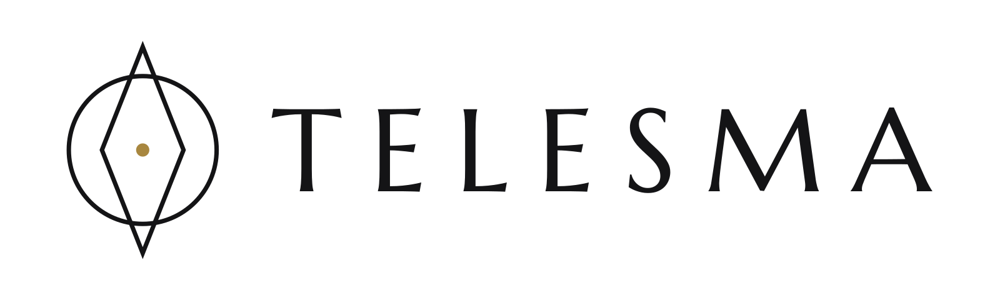
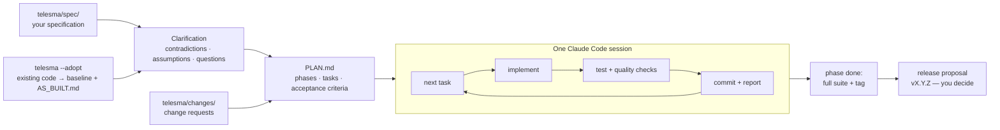
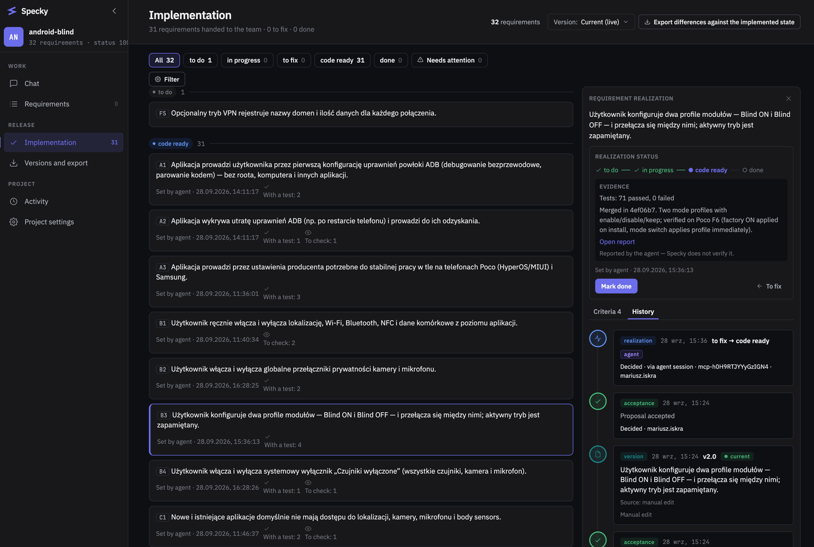
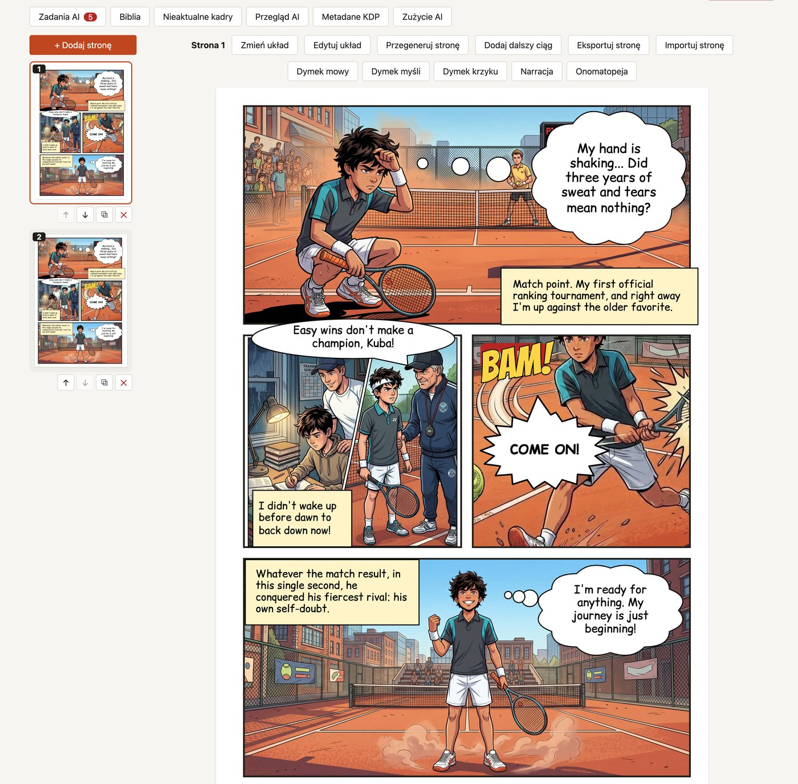
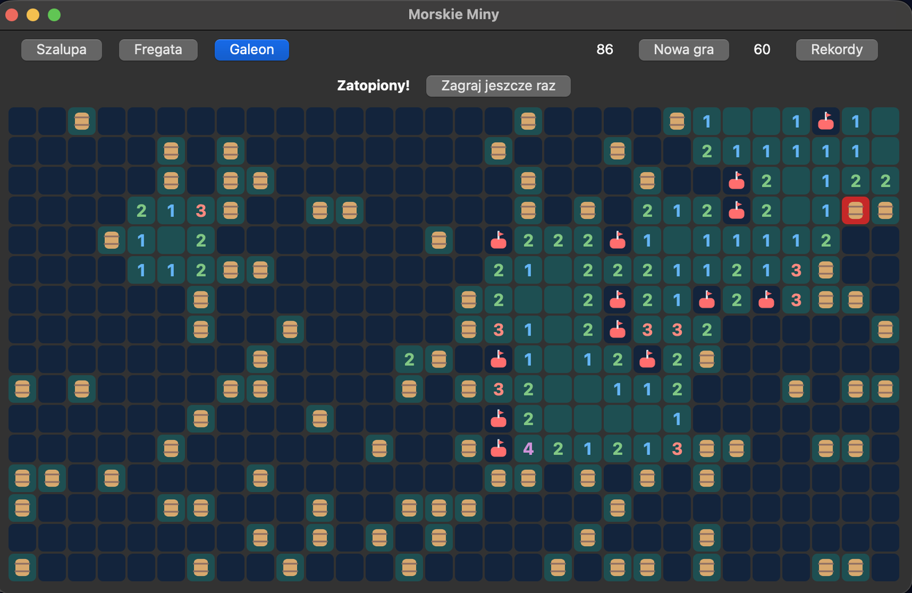

<h1 align="center">
  <picture>
    <source media="(prefers-color-scheme: dark)" srcset="docs/assets/telesma-logo-dark.svg">
    
  </picture>
</h1>

<p align="center">
  <b>Describe it. It builds it.</b><br>
  From a written specification — or the code you already have — to tested, committed code, in one continuous Claude Code session.
</p>

<p align="center">
  <a href="https://github.com/mario12358/telesma/actions/workflows/test.yml"></a>
  <a href="https://github.com/mario12358/telesma/releases"></a>
  <a href="LICENSE"></a>
  
</p>

<p align="center">
  <a href="#quick-start"><b>Developer quick start</b></a> ·
  <a href="#existing-code-adopt-it"><b>Existing code?</b></a> ·
  <a href="#not-a-programmer-start-here"><b>Not a programmer?</b></a> ·
  <a href="SHOWCASE.md"><b>Showcase</b></a> ·
  <a href="#faq"><b>FAQ</b></a> ·
  <a href="#documentation"><b>Docs</b></a>
</p>

**Telesma is an autonomous development loop for [Claude Code](https://docs.anthropic.com/en/docs/claude-code).**
Put a specification into `telesma/spec/`, answer the questions Telesma asks about it, and it turns
the spec into a plan and works through that plan task by task — implement, test, commit, report,
next — until the plan is done. **Code that already exists** gets the same treatment:
`telesma --adopt` records a test baseline, mines the git history and describes the system module
by module before anything is planned — [see below](#existing-code-adopt-it).

It builds on the [Ralph loop](https://ghuntley.com/ralph/) technique — run an agent in a loop over
a plan until the plan is done — and adds what a real project needs around it: a clarification
phase, contracts in the plan, state that survives compaction, quality checks and releases. Used
in production for over a year before its public release, on projects of up to about two thousand
planned tasks. The name is Greek: _télesma_, "completion, accomplishment" — the word "talisman"
comes from it.



## Why Telesma

Most Claude automation restarts the CLI for every task, or keeps one long chat that slowly forgets
what it was doing. Telesma does neither:

|                              | Claude Code, used by hand            | A plain Ralph loop                 | **Telesma**                                                    |
| ---------------------------- | ------------------------------------ | ---------------------------------- | -------------------------------------------------------------- |
| Where the spec comes from    | what you paste into the chat         | one prompt file                    | `telesma/spec/`, indexed; each task loads only its own lines   |
| Before the first line of code | you decide what to ask             | nothing                            | contradictions → assumptions → questions, then a plan          |
| Where the state lives        | the context window                   | the prompt file                    | `telesma/state/`, updated after every task — a restart resumes at the exact task |
| Definition of done           | whatever the model reports           | whatever the model reports         | green tests plus the task's acceptance criteria                |
| Who enforces the rules       | the prompt                           | the prompt                         | the launcher (validation, prompt diet) and git hooks (checks)  |
| A change after the start     | a new chat message                   | edit the prompt                    | a file in `telesma/changes/` → plan edits or a rework phase    |
| Releases                     | by hand                              | —                                  | proposed per phase, tagged only after you say yes              |
| Code that already exists     | you explain it in the chat, again    | —                                  | `--adopt`: a test baseline, a git digest, the system described module by module, then a plan from there |

In short: **one continuous session** in which Claude drives the loop itself, **state in files, not in
the context window**, and **the rules that matter enforced by scripts**, not by the model's memory.

## Is it for you?

**A good fit:** a new product or a substantial feature with a written specification (any format —
Markdown, Word, PDF, mockups), built over days or weeks, where you want the work to stay traceable:
the plan, the report, the decisions and every change request live in files in your repository.
Also an **existing codebase** — written by hand or with an assistant used the ordinary way — that
you want to keep developing with the same discipline: `telesma --adopt` describes it first, then
the next features are planned on top of what is really there.

**Not a fit:** a one-off fix or a small script (use Claude Code directly), or a project with no
automated tests — Telesma treats green tests as the definition of done, and the launcher stops
before the loop until test commands are set.

**Cost:** Telesma runs on your own Claude Code plan (Pro or Max) or API key. The implementation
itself is the bulk of the cost; the launcher keeps the startup prompt small, so the price of a
start stays flat as the project grows. For scale, the [showcase](SHOWCASE.md) lists programs of
20–50 tasks that took from under an hour to a few days of loop time, and a product of over a
thousand tasks built over half a year. A long autonomous run uses a noticeable part of a plan's
usage limits.

## Key features

- **Clarification first** — Telesma reads the whole spec, rates its quality, and walks you through
  contradictions, assumptions and an adaptive number of questions before it plans anything.
- **Adopt existing code** — `telesma --adopt` runs the tests once as the baseline, mines the git
  history (reverts, churn, fix hot spots, tag scheme) and lets a survey session write
  `telesma/spec/AS_BUILT.md`: one line per behaviour with the place in the code and whether a test
  covers it, plus the conventions found. Nothing in the code changes. → [Adopting](#existing-code-adopt-it)
- **Plan with contracts** — every task carries dependencies, spec references, technology
  guidelines, UI mockup references and acceptance criteria, including "what triggers this in the
  running product". → [Workflow](docs/WORKFLOW.md)
- **Selective retrieval** — the spec is never loaded whole; an anchored index points each task at
  the exact line range it needs.
- **48 technology guidelines** — clean-code rules plus one convention file per language,
  framework, database, infrastructure tool and test runner, loaded per task; add your own.
- **Four modes** — autonomous loop, bugfix chat, context-aware code review, visual-artifact backfill.
- **Change channel** — after clarification the spec is frozen; changes arrive as files in
  `telesma/changes/` and become plan edits or rework phases.
- **Releases** — proposed at the right moments, with manual test scenarios for what automated
  tests could not check; tagged only after you say yes.
- **Quality checks on git events** — secrets, weakened tests, hallucinated packages, known
  vulnerabilities, SAST, lint and types, an attack-surface map with red-team markers. → [Checks](docs/CHECKS.md)
- **Permission judge** — a hook that answers the permission prompts you would approve anyway, and
  only ever removes prompts, never adds blocks. → [Judge](docs/PERMISSION_JUDGE.md)
- **Integrations** (optional) — GitHub pull-request workflow and the Specky requirements tracker.
  → [Integrations](docs/INTEGRATIONS.md)
- **Cheap to restart** — state-file rotation, a startup-prompt diet and a git-based repair of
  damaged state files.

<details>
<summary>The 48 technology guidelines</summary>

Languages: Python, TypeScript, Go, Rust, Java, Kotlin, Swift, C#, PHP, Ruby.
Frameworks: React, Next.js, Vue, Svelte, Angular, React Native, Flutter, FastAPI, Django, Spring,
NestJS, Node, Deno, Hono, HTMX, Tailwind.
Data: SQL, PostgreSQL, MySQL, SQLite, MongoDB, Redis, GraphQL, REST API design.
Infrastructure: Docker, Kubernetes, Terraform, GitHub Actions, Caddy, observability, k6.
Testing: Playwright, Detox. Also: accessibility, LLM-powered features, robotics.
They live in `templates/guidelines/` and are copied to `telesma/guidelines/` in your project, where
your edits win.
</details>

## Built with Telesma

<table>
  <tr>
    <td align="center" width="33%"><a href="SHOWCASE.md#specky"></a><br><b>Specky</b><br>a requirements tracker for coding agents<br><sub>a developer · 6 months · 1100+ tasks · 45 versions</sub></td>
    <td align="center" width="33%"><a href="SHOWCASE.md#books-creator"></a><br><b>Books Creator</b><br>comics and picture books with AI-drawn panels<br><sub>a developer · 5 weeks · 169 tasks · 18 change requests</sub></td>
    <td align="center" width="33%"><a href="SHOWCASE.md#morskie-miny"></a><br><b>Morskie Miny</b><br>Minesweeper at sea, a macOS app<br><sub>a person who does not program · 41 minutes · 21 tasks</sub></td>
  </tr>
</table>

Six programs, with what they took: [SHOWCASE.md](SHOWCASE.md).

## Not a programmer? Start here

Telesma takes you from an idea to a program on your computer. It asks what you want, writes it
down, builds the program, tests it and hands it to you as one file to open with a double-click.
After one line pasted during the installation, you never type a command.

**1. Install it.** One line, copied and pasted. The installer says what it is about to install and
asks before each step; at the end there is a **Telesma** icon on your desktop.

- **Windows 10 or 11**: press Start, type *PowerShell* and open it (the normal one, not "Run as
  administrator"). Paste this line and press Enter:
  ```powershell
  irm https://raw.githubusercontent.com/mario12358/telesma/main/install.ps1 | iex
  ```
- **Mac**: press ⌘ Space, type *Terminal* and open it. Paste this line and press Enter:
  ```bash
  curl -fsSL https://raw.githubusercontent.com/mario12358/telesma/main/install.sh | bash
  ```

It installs the few programs Telesma needs, then Claude Code, and opens your browser to sign in to
your Claude account. When a new Telesma version is out, Telesma says so at the start and asks
whether to update; the same install line, run again, does it too.

**2. Double-click Telesma.** A menu opens: *a new idea*, or one of your programs. Pick a new idea
and Telesma interviews you: six plain questions, one at a time, about ten minutes. It reads the
answers back, asks about a few details, plans the work and builds. When the program is ready it
opens the folder with it and says what to try. Later, the same icon shows your programs with
*Build on* and *Something does not work right*. Your programs live in a *Telesma* folder in your
home folder. [Six programs built this way](SHOWCASE.md).

**Good to know before you start:**

- You need a Claude account with a paid plan (Pro or Max). There is no free way, and building a
  program uses a good part of a plan's monthly limit.
- Claude asks before some actions (installing something, deleting files). Telesma words those
  questions plainly, but you answer them.
- A program is built on the kind of computer it is for: a Windows program on Windows, a Mac
  program on a Mac. The interview offers a program with a window, a page in your browser on your
  own computer, or a command-line tool. A website for other people or a phone app needs hosting,
  accounts and app stores, so the interview does not offer it yet — Telesma itself builds those
  too, from a written specification (the developer path below; see the [showcase](SHOWCASE.md)).
- A freshly built program has no publisher signature. Windows may warn once ("More info" → "Run
  anyway"); Windows 11 with *Smart App Control* on refuses it altogether — Telesma says so before
  building and what the choice is.
- Something wrong? Double-click Telesma, pick the program, choose *Something does not work right*
  and say what you saw.

## Requirements

| Required                                                                     | Optional                                                                        |
| ---------------------------------------------------------------------------- | ------------------------------------------------------------------------------- |
| `bash` (3.2+, the macOS default works)                                       | `gh` (GitHub CLI ≥ 2.41) — GitHub integration                                   |
| `python3` (standard library only)                                            | `gitleaks` — wider secret detection in the `secrets` check                      |
| [Claude Code CLI](https://docs.anthropic.com/en/docs/claude-code) (`claude`) | `semgrep` — OWASP rule packs in the `sast` check                                |
| `git`                                                                        | `pandoc` — converts `.docx` / `.pdf` / `.odt` / `.rtf` files in `telesma/spec/` |

Nothing is added to your project's dependencies. Every start checks the required column (and that
Claude Code is signed in) and says what to install; `telesma --doctor [project]` runs the same check
on its own. On Windows Telesma runs in Git Bash, which Claude Code needs there too.

## Quick start

**1. Install.** The same one line as above (macOS, Linux, or PowerShell on Windows). It gets what
is missing, puts Telesma in `~/.telesma` and the `telesma` command in `~/.local/bin` (next to
`claude`), and adds a desktop shortcut you can ignore. Every start checks for a newer release and
offers to update (`TELESMA_NO_UPDATE_CHECK=1` turns the check off).

```bash
curl -fsSL https://raw.githubusercontent.com/mario12358/telesma/main/install.sh | bash
```

<details>
<summary>Prefer to read it first, or to clone by hand?</summary>

```bash
curl -fsSL https://raw.githubusercontent.com/mario12358/telesma/main/install.sh -o install.sh
less install.sh && bash install.sh
# or, without the installer (no Claude Code install, no shortcut):
git clone https://github.com/mario12358/telesma.git ~/.telesma
ln -s ~/.telesma/telesma.sh ~/.local/bin/telesma     # or call ~/.telesma/telesma.sh directly
```
</details>

**2. Point it at a project.** You always run the same command; Telesma reads the project's state
and does the next right thing:

```bash
telesma /path/to/project
```

| Run | What happens                                                                                     |
| --- | ------------------------------------------------------------------------------------------------ |
| 1st | creates `telesma/spec/` with one template and prints what goes where                             |
| 2nd | a spec is there → creates `telesma/config.md` and runs the setup wizard (ENTER accepts each recommended answer) |
| 3rd | clarification: contradictions → assumptions → questions, then `telesma/state/PLAN.md`          |
| 4th | the mode menu → the autonomous loop                                                              |

The wizard and the clarification each end by offering to go straight on, so in practice it is one
or two starts. Skip the menu with `telesma /path/to/project -m 1`; add `-i` to watch and answer.

**Just an idea, no spec?** `telesma --new /path/to/project` interviews you and writes
`telesma/spec/` itself (the idea in your words, numbered requirements with "when …, then …"
checks, the user flows, the technology), then runs the setup. It sets `Experience: beginner`
(plain words); `--setup` switches it back.

**Code that already exists?** Start with `telesma --adopt /path/to/project` instead — the
section [Existing code? Adopt it](#existing-code-adopt-it) walks through it.

**3. Write the specification.** Everything Telesma reads and writes in your project lives in one
`telesma/` directory:

```
your-project/
├── telesma/
│   ├── config.md     configuration (tests, git, integrations, checks, judge, telemetry)
│   ├── spec/         your specification — frozen after clarification
│   ├── changes/      change requests after the freeze (+ processed/)
│   ├── state/        written by Telesma: PLAN.md, REPORT.md, PROJECT_CONTEXT.md, SPEC_INDEX.md, logs
│   ├── guidelines/   technology guidelines (copied from Telesma, your edits win)
│   ├── checks/       quality-check modules (only with checks enabled)
│   └── artifacts/    screenshots and recordings (only with visual artifacts enabled)
├── .claude/          Claude Code settings and the permission-judge hook (Claude Code looks for them here)
└── docs/             RUNBOOK.md and test-scenarios/ — documentation of your project, not of Telesma
```

- `telesma/spec/TECHNICAL_GUIDELINES.md` — fill in **only** where you depart from the defaults in
  `telesma/guidelines/` (a mandated stack, hosting, compliance, SLA). Left as it is, the defaults
  apply; delete the `TELESMA_SPEC_TEMPLATE` marker from its first line once you fill something in.
- Any other files with the business and functional requirements: goals, use cases, user stories,
  domain model, business rules, acceptance criteria, diagrams. Any format.
- Optional: mockups, design tokens and reference components in `telesma/spec/ux_ui/`.

**4. The setup wizard** asks one question per module — language and experience, profile
(`minimal` / `recommended` / `full`), the stack and test commands it detected from your manifests,
the permission judge, the quality-check tier — and writes `telesma/config.md`, where every key is
commented. Change anything later with `telesma --setup` or by editing the file.
→ [Configuration](docs/CONFIGURATION.md)

## Existing code? Adopt it

Telesma used to start only from a specification and an empty directory. Since 1.3 it takes over
code it did not write — a project built by hand, or with Claude Code, Codex or Cursor used the
ordinary way — without inventing a history for it:

```bash
telesma --adopt /path/to/project     # preconditions, the setup wizard, Adopted: yes
telesma /path/to/project             # the baseline and the survey; add -i to watch
```

1. **Preconditions a survey can stand on.** Source code, a git repository with a commit (none →
   Telesma offers `git init` and a first commit, after putting anything that looks like a secret
   or build output into `.gitignore`), a clean tree. The commit it finds becomes `Adopted at` in
   `telesma/config.md` — the state the survey describes. Then the setup wizard, as on any first
   start; the test command matters most here.
2. **The launcher, without a model.** It runs the **full test suite once** and records the result
   in `telesma/state/REPORT.md` as the baseline — from then on a test that was already red is an
   inherited failure, not a regression; runs the quality checks once over the whole repository
   when they are on (findings listed, nothing blocked); mines the git history into a short digest —
   tag scheme, reverts, churn, the files with the most fix commits, dependency changes, test ratio,
   never an author or a commit subject; and writes `### Phase 0: Existing system` into the plan,
   one task per part of the code.
3. **The survey session** works through Phase 0 like any other phase. For each part it reads the
   tests and the public surface and appends a section to `telesma/spec/AS_BUILT.md`: one
   `When …, then …` line per behaviour, with the place in the code and a tag — `[verified by
   test: …]` or `[inferred]` — plus open questions for what the code does not explain. It fills
   `PROJECT_CONTEXT.md` (stack, architecture, decisions and pitfalls visible in the code and the
   history) and records the conventions it found — including what your own `CLAUDE.md` says — in
   `TECHNICAL_GUIDELINES.md`. It may write only inside `telesma/`; a write anywhere else is
   refused by the session's permissions. It commits after every part, so an interrupted survey
   continues at the next start.
4. **Then it is your turn.** Correct `AS_BUILT.md` where the survey guessed wrong, answer the
   open questions in place or leave them, put a file into `telesma/spec/` with what should happen
   next — and start as usual. The clarification indexes everything, keeps Phase 0 as it is and
   plans from Phase 1; a red baseline or no tests makes it propose a safety net of
   characterisation tests first. Code review (`-m 3`) and bugfix (`-m 2`) already work from the
   survey alone, before any plan exists.

Why no task history is rebuilt from the commits, and what the first version deliberately leaves
out: [docs/ARCHITECTURE.md §21](docs/ARCHITECTURE.md#21-adopting-an-existing-project). The user's
side in full: [docs/WORKFLOW.md §19](docs/WORKFLOW.md#19-adopting-an-existing-project).

## How a session works

1. **Clarification** (interactive, once): Telesma indexes `telesma/spec/` with line ranges and a
   quality assessment, then asks — few questions for a small, well-written spec, many for a thin one.
   An adopted project gets here after the survey, with `AS_BUILT.md` among the spec files.
2. **Planning**: from the spec and your answers it writes `telesma/state/PLAN.md` — phases, tasks
   with dependencies, acceptance criteria, and a coverage table mapping every spec section to tasks.
3. **Startup checks** (every run, no tokens): the launcher validates the plan and the config,
   rotates and repairs state files, applies framework updates and assembles a trimmed prompt.
4. **The loop**: for each task, load its spec fragment and guidelines → implement → test → verify
   the acceptance criteria → mark done → update the report → commit specific files.
5. **End of phase and finish**: the full suite (a regression beats new work), a progress tag and a
   release proposal; at the end `docs/RUNBOOK.md` and `TELESMA COMPLETE`. Stuck → `TELESMA BLOCKED`
   with a concrete question, saved for the next start. The session stays open; everything you say
   from then on is logged to `telesma/state/DECISIONS.md`.

Details, including the plan format, change requests and releases: [docs/WORKFLOW.md](docs/WORKFLOW.md).

## Modes

After clarification the launcher asks for a mode, or you pass `-m`:

| Mode | Name                     | What it does                                                                                                   | Interactive     |
| ---- | ------------------------ | -------------------------------------------------------------------------------------------------------------- | --------------- |
| 1    | **autonomous** (default) | The loop over `telesma/state/PLAN.md`                                                                          | optional (`-i`) |
| 2    | **bugfix**               | Chat: you report a bug → diagnosis → proposal → your OK → fix → test → commit → `telesma/state/BUGFIXES.md`     | always          |
| 3    | **review**               | Chat: code review of a chosen scope against your spec, guidelines and decisions → `telesma/state/REVIEWS.md`   | always          |
| 4    | **artifacts**            | Backfills missing screenshots and flow recordings; idempotent, never edits the plan                            | optional (`-i`) |

Other launcher commands:

```bash
telesma --setup /path/to/project         # configuration menu: tests, judge, checks, integrations, artifacts, language
telesma --repair /path/to/project        # repair state files from git history, then exit
telesma --integrations /path/to/project  # only the integrations wizard on an existing project
telesma --sync-specky /path/to/project   # pull Specky changes into telesma/changes/, no loop
telesma --doctor [project]               # what this machine still needs
```

## Integrations

Telesma has **no integration by default**: it commits to the current branch and never pushes. An
integration is a separate instruction module, added to the prompt only when `telesma/config.md`
names it.

- **GitHub** — one branch and one pull request per task; a task is done when its PR is merged.
  "Merge only on green" is enforced, not promised: the permission hook runs its own `gh pr checks`
  before letting a merge through, pushes go only to task branches, and release tags are never pushed.
- **[Specky](https://app.specky.app)** — the specification as a contract between a human and an
  agent: requirements with acceptance criteria and content hashes, accepted by a human. Every task
  is anchored to a requirement version, a marked test proves a criterion through your CI's JUnit
  report, and a release becomes a Specky snapshot. Specky is a product by the author of Telesma;
  Telesma works fully without it.

Full reference: [docs/INTEGRATIONS.md](docs/INTEGRATIONS.md).

## Safety

- **Permission judge** — a Claude Code hook that answers permission prompts on your behalf. Its
  governing rule: **it only removes prompts, it never adds blocks.** Hard patterns (`rm -rf`,
  `sudo`, `git push`, writes to `.claude/` or `telesma/config.md`) and your own "always ask" list
  always reach you; only the gray zone goes to an optional model, and anything but a clear ALLOW
  still asks. → [docs/PERMISSION_JUDGE.md](docs/PERMISSION_JUDGE.md)
- **Quality checks** — triggered by git operations (before a commit, a phase tag, a release tag,
  and in CI), not by the model remembering to run them; a false positive is waived by a human
  only, in `telesma/state/CHECK_EXCEPTIONS.md`. → [docs/CHECKS.md](docs/CHECKS.md)
- **Telemetry** — off by default; optional quality events about Telesma's own work, sent only after
  an explicit opt-in on your machine, never your spec or code. → [docs/TELEMETRY.md](docs/TELEMETRY.md)
- **Commit footer** — every commit, PR and PR comment Telesma writes ends with exactly
  `🤖 Generated with Telesma`; no model name, tool name or session link.

## Language and experience

`Language` in `telesma/config.md` (default `en`) sets the language Telesma talks to you in and
writes prose in — report entries, decisions, test scenarios; any code works, and structural tokens
stay English because scripts parse them. `Experience: beginner` switches to plain words, one
question at a time with a proposed answer, and progress in one sentence — the same loop, prompts
and files. `telesma --new` sets it; `--setup` changes it. → [docs/CONFIGURATION.md](docs/CONFIGURATION.md)

## FAQ

**Can I use it on an existing codebase?**
Yes: `telesma --adopt /path/to/project`. Telesma does not reconstruct a task history from commits
(nothing would read it); it records a test baseline, mines the git history into a short digest,
and a survey session writes `telesma/spec/AS_BUILT.md` — the system as found, one line per
behaviour with the place in the code and whether a test covers it — plus the project context. You
correct that file, add what should happen next, and the clarification plans from Phase 1; code
review and bugfix work right after the survey. → [docs/WORKFLOW.md §19](docs/WORKFLOW.md#19-adopting-an-existing-project)

**Does it work with an API key instead of a Pro or Max plan?**
Yes. Claude Code runs on either; with `ANTHROPIC_API_KEY` set, the sign-in check is skipped.

**Can I stop it and continue tomorrow?**
Yes. State lives in `telesma/state/` and is updated after every task; the next start resumes at
the exact task. `telesma --repair` rebuilds damaged state files from git history.

**What if my project has no tests yet?**
For a new project the plan's first tasks set up the test harness, and the first start after the
plan proposes the test commands. For a project that cannot have automated tests, Telesma is the
wrong tool: green tests are its definition of done.

**Does it push to my remote?**
Not by default: it commits to the current branch and never pushes. With the GitHub integration it
pushes task branches only; release tags are never pushed by Telesma.

**Can I use a model other than Claude?**
No. Telesma is a layer on top of Claude Code and uses its session, hooks and `/compact`. The
optional permission judge can use a separate, cheaper model for its gray zone.

**How is this different from Claude Code's own plan mode or subagents?**
Those plan and act inside one context window. Telesma keeps the plan, the report and the decisions
in files, validates them with scripts before every start, and makes green tests plus acceptance
criteria the definition of done — so a project survives compactions, restarts and weeks of work.

## Documentation

| Document                                             | Contents                                                                  |
| ---------------------------------------------------- | ------------------------------------------------------------------------- |
| [SHOWCASE.md](SHOWCASE.md)                           | Programs built with Telesma, and how to add yours                         |
| [docs/WORKFLOW.md](docs/WORKFLOW.md)                 | Clarification, plan format and tags, modes, changes, releases, monitoring, adopting existing code |
| [docs/CONFIGURATION.md](docs/CONFIGURATION.md)       | The setup wizard, every `telesma/config.md` section and key, launcher flags |
| [docs/STATE_FILES.md](docs/STATE_FILES.md)           | Files Telesma creates in your project, rotation, prompt diet, `--repair`  |
| [docs/TROUBLESHOOTING.md](docs/TROUBLESHOOTING.md)   | Common problems and what to do                                            |
| [docs/INTEGRATIONS.md](docs/INTEGRATIONS.md)         | GitHub and Specky integrations in detail                                  |
| [docs/PERMISSION_JUDGE.md](docs/PERMISSION_JUDGE.md) | The permission judge: layers, variants, evaluation                        |
| [docs/CHECKS.md](docs/CHECKS.md)                     | Quality checks, attack-surface map, PR status                             |
| [docs/TELEMETRY.md](docs/TELEMETRY.md)               | Optional self-hosted quality telemetry                                    |
| [docs/ARCHITECTURE.md](docs/ARCHITECTURE.md)         | How the launcher, instructions, hooks and tools fit together              |
| [benchmark/README.md](benchmark/README.md)           | Frozen benchmark for comparing Telesma versions                           |
| [CONTRIBUTING.md](CONTRIBUTING.md)                   | How to contribute, conventions, self-tests                                |
| [SECURITY.md](SECURITY.md)                           | Reporting vulnerabilities                                                 |
| [CHANGELOG.md](CHANGELOG.md)                         | Release history                                                           |

## License

MIT — see [LICENSE](LICENSE).

## Author

Mariusz Iskra — mariusz.iskra@gmail.com
Commercial inquiries: Sparkit — biuro@sparkit.pl
