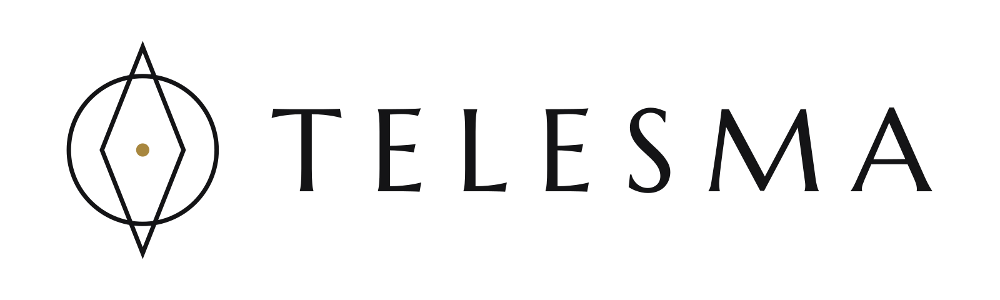
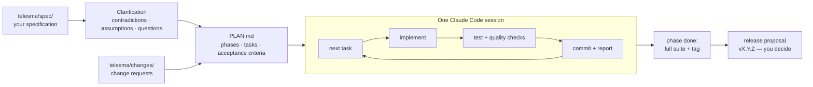

<h1 align="center">
  <picture>
    <source media="(prefers-color-scheme: dark)" srcset="docs/assets/telesma-logo-dark.svg">
    
  </picture>
</h1>

<p align="center">
  <b>From a written specification to tested, committed code — in one continuous Claude Code session.</b>
</p>

<p align="center">
  <a href="https://github.com/mario12358/telesma/actions/workflows/test.yml"></a>
  <a href="LICENSE"></a>
</p>

**Telesma is an autonomous development loop for [Claude Code](https://docs.anthropic.com/en/docs/claude-code).**
You put a specification into `telesma/spec/`, answer the questions Telesma asks about it, and Telesma turns it
into a plan and works through that plan task by task — implement, test, commit, report, next —
inside a single, continuous Claude Code session.

Telesma builds on the "Ralph loop" technique — run an agent in a loop over a plan until the plan is
done — and adds what a real project needs around it: clarification, contracts in the plan, state
that survives compaction, quality checks and releases. The name is Greek: _télesma_, "completion,
accomplishment" — the word "talisman" comes from it.

Telesma has been used in production for over a year before its public release, on projects of up to
about two thousand planned tasks; the mechanisms described below come from that experience.



## Why Telesma

Most Claude automation restarts the CLI for every task, or keeps one long chat that slowly forgets
what it was doing. Telesma does neither:

- **One continuous session.** Claude runs the iteration loop itself: pick the next task (respecting
  dependencies), load only the spec fragments and conventions that task needs, implement, run the
  tests, check for regressions, mark the task done, commit, and move on.
- **State lives in files, not in the context window.** `telesma/state/PLAN.md`, `telesma/state/REPORT.md` and
  `telesma/state/PROJECT_CONTEXT.md` are updated after every task, so an auto-compaction or a restart
  resumes exactly where the work stopped.
- **The rules that matter are enforced by scripts, not by the model's memory.** The launcher
  validates the plan and the config, rotates state files and trims the startup prompt before a
  single token is spent; git hooks run quality checks on every commit and tag; a permission hook
  removes prompts you would have approved anyway.

## Is it for you?

**A good fit:** a new product or a substantial feature with a written specification (any format —
Markdown, Word, PDF, mockups), built over days or weeks, where you want the work to stay traceable:
the plan, the report, the decisions and every change request live in files in your repository.

**Not a fit:** a one-off fix or a small script (use Claude Code directly), or a project with no
automated tests — Telesma treats green tests as the definition of done, and the launcher stops
before the loop until test commands are set.

**Cost:** Telesma runs on your own Claude Code plan or API key. Long autonomous runs consume a
noticeable part of a plan's usage limits; the launcher keeps the startup prompt small, but the
implementation itself is the bulk of the cost.

## Key features

- **Clarification phase** — Telesma reads the whole spec, rates its quality, and walks you through
  contradictions, assumptions and an adaptive number of questions before it plans anything.
- **Plan with contracts** — tasks carry dependencies `(requires:)`, spec references `(spec:)`,
  technology guidelines `(tech:)`, UI mockup references `(ui-*:)` and acceptance criteria `- AC:`,
  including `- AC: entry` ("what triggers this in the running product").
- **Selective retrieval** — the spec is never loaded whole; an anchored index points each task at
  the exact line range it needs.
- **Technology guidelines** — general clean-code rules plus 46 convention files — languages (Python, TypeScript, Go, Rust, Java,
  Kotlin, Swift, C#, PHP, Ruby), frameworks (React, Next.js, Vue, Svelte, Angular, React Native,
  Flutter, FastAPI, Django, Spring, NestJS, Node, Deno, Hono, HTMX, Tailwind), data (SQL, PostgreSQL,
  MySQL, SQLite, MongoDB, Redis, GraphQL, REST API design), infrastructure (Docker, Kubernetes,
  Terraform, GitHub Actions, Caddy, observability, k6), testing (Playwright, Detox), accessibility,
  LLM-powered features, robotics — loaded per task; add your own.
- **Four modes** — autonomous loop, bugfix chat, context-aware code review, visual-artifact backfill.
- **Change channel** — after clarification the spec is frozen; changes arrive as files in
  `telesma/changes/` and become plan edits or rework phases.
- **Releases** — Telesma proposes a release version at the right moments, writes manual test
  scenarios for what automated tests could not check, and tags only after you say yes.
- **Integrations** (optional) — GitHub pull-request workflow and the Specky requirements tracker.
- **Quality checks** (optional) — secrets, deliberate weakenings, hallucinated packages, known
  vulnerabilities, weakened tests, repository hygiene, dead entry points, SAST, lint/types, and an
  attack-surface map with red-team markers — all triggered by git operations.
- **Permission judge** (optional) — a hook that answers permission prompts for you, and only ever
  removes prompts, never adds blocks.
- **Cheap to restart** — state-file rotation, a startup-prompt diet and a state-file diagnosis with
  a git-based repair keep the cost of a start flat as the project grows.

## What's inside

| Module | What it does | Where |
| --- | --- | --- |
| **Launcher** | Prepares the project, validates the plan and the config, rotates state files, assembles the startup prompt, starts Claude Code | `telesma.sh` |
| **Instruction modules** | The rules the model follows — clarification, the core loop, the post-loop conversation, one module per mode — loaded only when the mode needs them | `templates/instructions/` |
| **State files** | The memory that survives compaction and restarts: plan, report, project context, spec index, decision / bugfix / review logs | `telesma/state/` in your project |
| **Setup wizard** | First start and `--setup`: profile (minimal / recommended / full), stack detection → test commands, permission judge, check tier, integrations, visual artifacts, language | `templates/setup/` |
| **State-file templates** | The shape of the plan, report, project context, spec index, questions, backlog, test scenarios — the contract between the model and the scripts | `templates/*.md` |
| **Technology guidelines** | General clean-code rules plus 46 convention files, loaded per task by `(tech:)` tags | `templates/guidelines/` |
| **Permission judge** | A Claude Code hook that answers permission prompts you would approve anyway — it only removes prompts, never adds blocks; its one refusal is the loop's contract (merge only on green, no release-tag push), which holds even in Claude Code's `auto` mode | `templates/hooks/` |
| **Quality checks** | 11 modules run on git operations: secrets, weakenings, dependencies, dependency audit, weakened tests, hygiene, dead entry points, SAST, lint/types, attack-surface map, red-team markers | `templates/checks/` |
| **Integrations** | GitHub pull-request workflow and the Specky requirements tracker, each an optional instruction module | `templates/integrations/` |
| **Tools** | State-file repair, self-hosted quality telemetry, Specky release snapshots, judge evaluation | `tools/` |
| **Benchmark** | A frozen project with a hidden HTTP judge, for comparing Telesma versions | `benchmark/` |

## Requirements

| Required                                                                     | Optional                                                                        |
| ---------------------------------------------------------------------------- | ------------------------------------------------------------------------------- |
| `bash` (3.2+, the macOS default works)                                       | `gh` (GitHub CLI ≥ 2.41) — GitHub integration                                   |
| `python3` (standard library only)                                            | `gitleaks` — wider secret detection in the `secrets` check                      |
| [Claude Code CLI](https://docs.anthropic.com/en/docs/claude-code) (`claude`) | `semgrep` — OWASP rule packs in the `sast` check                                |
| `git`                                                                        | `pandoc` — converts `.docx` / `.pdf` / `.odt` / `.rtf` files in `telesma/spec/` |

Telesma is cloned, not installed. Nothing is added to your project's dependencies.

## Quick start

### 1. Clone Telesma

```bash
git clone https://github.com/mario12358/telesma.git ~/tools/telesma
```

### 2. Initialise your project

```bash
~/tools/telesma/telesma.sh /path/to/project
```

The first run creates `telesma/spec/` with one template and prints what goes where. Everything
Telesma reads and writes in your project lives in that one `telesma/` directory:

```
your-project/
├── telesma/
│   ├── config.md     configuration (tests, git, integrations, checks, judge, telemetry)
│   ├── spec/         your specification — frozen after clarification
│   ├── changes/      change requests after the freeze (+ processed/)
│   ├── state/        written by Telesma: PLAN.md, REPORT.md, PROJECT_CONTEXT.md, SPEC_INDEX.md, logs
│   ├── guidelines/   technology guidelines (copied from Telesma, your edits win)
│   ├── checks/       quality-check modules (only with checks enabled)
│   └── artifacts/    screenshots and recordings (only with visual artifacts enabled)
├── .claude/          Claude Code settings and the permission-judge hook (Claude Code looks for them here)
└── docs/             RUNBOOK.md and test-scenarios/ — documentation of your project, not of Telesma
```

### 3. Write the specification

- `telesma/spec/TECHNICAL_GUIDELINES.md` — fill in **only** the fields where you depart from the defaults
  in `telesma/guidelines/` (a mandated stack, hosting, integrations, compliance or SLA requirements).
  An empty field means the default wins. Delete the `TELESMA_SPEC_TEMPLATE` marker from its first
  line when you are done.
- Any other files with business and functional requirements: goals, use cases, user stories,
  domain model, business rules, acceptance criteria, diagrams. Any format.
- Optional: mockups, design tokens and reference components in `telesma/spec/ux_ui/`.

### 4. Run the setup wizard

```bash
~/tools/telesma/telesma.sh /path/to/project
```

With a specification in place, the second run creates `telesma/config.md` and walks you through
it, one module per question, ENTER accepting the recommended answer:

| Step | What it decides | Recommended |
|---|---|---|
| Profile | `minimal` (the loop only), `recommended`, `full` | `recommended` |
| Stack and tests | Detects the stack from manifests (`pyproject.toml`, `package.json`, `Cargo.toml`, `go.mod`, …, also one level down in a monorepo) and proposes the test, lint and typecheck commands; a project with no code yet picks a stack from a list | detected |
| Permission prompts | The permission judge: `rules` (no model — provable reads pass, everything else still asks you), `command` (a model decides the gray zone), `off` | `rules` |
| Quality checks | `basic` (secrets, weakenings, weakened tests, hygiene — no network, no tools), `standard` (+ dependencies, vulnerability audit, SAST, lint/types, dead entry points), `security` (+ attack-surface map, red team), `none` | `basic` |
| Integrations, visual artifacts, telemetry | Asked in the `full` profile (or when mockups are already in `spec/ux_ui/`) | off |
| Language | The language Telesma talks and writes prose in | `en` |

It ends with a summary and the next command. Change anything later with `telesma.sh --setup` (a
menu with the state of every module) or by editing `telesma/config.md` — every key is commented
there and documented in [docs/CONFIGURATION.md](docs/CONFIGURATION.md). Without a terminal (CI) the
wizard applies the recommended profile silently.

### 5. Clarify

```bash
~/tools/telesma/telesma.sh /path/to/project -i
```

Telesma indexes the spec, then guides you through contradictions → assumptions → questions (you can
stop and resume at any point; ENTER accepts the proposed answer). Afterwards it writes
`telesma/state/PLAN.md` and sets `Clarified: yes`.

### 6. Build

```bash
~/tools/telesma/telesma.sh /path/to/project          # mode menu
~/tools/telesma/telesma.sh /path/to/project -m 1     # autonomous loop, no menu
```

## How a session works

1. **Clarification** (`Clarified: no`, always interactive). Claude reads everything in `telesma/spec/`,
   writes `telesma/state/SPEC_INDEX.md` (a two-level index with line ranges, anchors and a quality
   assessment of the documentation) and `telesma/state/QUESTIONS.md` with three sections: contradictions to
   resolve, assumptions to spot-check and questions — few for a small, well-written spec, many for
   a large or thin one.
2. **Planning.** From the spec plus your answers Claude writes `telesma/state/PLAN.md`: phases, tasks with
   dependencies and tags, acceptance criteria, task 1.1 "architecture skeleton", and a
   `## Spec coverage` table mapping every spec section to tasks (or to a stated reason it is out of
   scope).
3. **Startup checks** (every run, no tokens spent). The launcher validates the plan (dependency
   graph, cycles, tags vs files) and the config, rotates state files into archives, diagnoses
   state-file damage, applies framework updates to the project, computes a next-task hint and
   assembles a trimmed startup prompt from the instruction modules your mode needs.
4. **The loop.** For each task: check dependencies → load the spec fragment, guidelines and UI
   fragments → implement → run the task tests and the smoke suite → verify the acceptance criteria
   → capture screenshots/recordings if enabled → mark ✅ → update the report → commit specific
   files (never `git add -A`).
5. **End of phase.** Full test suite for regression detection (a regression takes priority over
   new work); a green suite gets the progress tag `telesma/phase-<ID>` and a release proposal.
   Phases with UI end with an e2e task (Playwright or Detox).
6. **Finish.** When everything is done Claude writes `docs/RUNBOOK.md` (env vars, dev/test/build
   commands, seeding, ports) and prints `TELESMA COMPLETE`. If it gets stuck it prints
   `TELESMA BLOCKED` with a concrete question and saves it to `telesma/state/BLOCKED.md` for the next start.
7. **Afterwards.** The session stays open. Every exchange you have with Claude from here on is
   logged to `telesma/state/DECISIONS.md`; ideas for later go to `telesma/state/BACKLOG.md`.

Details: [docs/WORKFLOW.md](docs/WORKFLOW.md).

## Modes

After clarification the launcher asks for a mode, or you pass `-m`:

| Mode | Name                     | What it does                                                                                                                                     | Interactive     |
| ---- | ------------------------ | ------------------------------------------------------------------------------------------------------------------------------------------------ | --------------- |
| 1    | **autonomous** (default) | The loop over `telesma/state/PLAN.md`                                                                                                            | optional (`-i`) |
| 2    | **bugfix**               | Chat: you report a bug → diagnosis → proposal → your OK → fix → test → commit → entry in `telesma/state/BUGFIXES.md`                             | always          |
| 3    | **review**               | Chat: local code review of a chosen scope against your spec, guidelines and project decisions; findings by severity → `telesma/state/REVIEWS.md` | always          |
| 4    | **artifacts**            | Backfills missing screenshots and flow recordings; idempotent, never edits the plan                                                              | optional (`-i`) |

Other launcher commands:

```bash
telesma.sh --setup /path/to/project         # configuration menu: tests, judge, checks, integrations, artifacts, language
telesma.sh --repair /path/to/project        # repair state files from git history, then exit
telesma.sh --integrations /path/to/project  # run only the integrations wizard on an existing project
telesma.sh --sync-specky /path/to/project   # pull Specky changes into telesma/changes/, no loop
```

## Integrations

Telesma has **no integration by default**: it commits to the current branch and never pushes. Each
integration is a separate instruction module that is added to the prompt only when
`## Integrations` in `telesma/config.md` names it, so a project without integrations pays nothing for
them. The integrations wizard (`--integrations`, also a step of the setup wizard) checks the tools,
writes only `telesma/config.md` and explains in ten lines how the result will behave.

### GitHub

- **One branch and one pull request per task** (`task-<id>-<slug>`). PR title and body are the
  commit subject and body, so squash merges keep the commit's trailers.
- **A task is done when its PR is merged**, not when it is opened. Until then the task line carries
  `(pr: #n)` and stays unchecked, so phase completeness, phase tags and release proposals all fall
  in the right place.
- **Three merge modes**: `agent` (default — Telesma waits for the required checks and squash-merges
  itself; works on a private repository on GitHub Free), `auto` (GitHub auto-merge with branch
  protection), `manual` (a human merges).
- **"Merge only on green" is enforced, not promised.** With the permission judge enabled, the hook
  runs its own `gh pr checks` before letting `gh pr merge` through; a missing required check is not
  a green one, and a merge on red is refused even in Claude Code's `auto` permission mode, where the
  judge's questions would reach nobody. Pushes are allowed only to branches with the task prefix;
  release tags are never pushed by Telesma.
- A red check is fixed on the same branch; reaching the open-PR limit ends the session with
  `TELESMA WAITING` (nothing is broken — merge and start again). Stacked branches are merged bottom-up
  with a retarget and a rebase.

### Specky

[Specky](https://app.specky.app) is a requirements tool: it keeps the specification as a **contract
between a human and an agent** — requirements with acceptance criteria and content hashes, and
explicit human acceptance. The agent proposes; the human decides. With `Tracker: specky`:

- **Requirement anchors on tasks** — `- Specky: (req: <id> v<n>.<r> @<hash7>)` under each task. Before a
  task Telesma checks its anchors; a requirement that changed since the plan was written is re-read
  before coding, and the requirement is marked code-ready with its hash once built.
- **Trailers in commits** — `Specky-Req: <id>@<hash7>` ties each commit to the requirement version
  it implements (the PR body carries it through a squash merge).
- **Criteria evidence from CI** — a test marked `specky: crit <criterion_id>` proves a criterion via
  the JUnit report your CI publishes (a `specky-ci.yml` template with the contract in its header is
  provided). Evidence is the CI result, not the agent's word.
- **Requirement changes as change files** — `what_changed` and the work queue are materialised as
  files in `telesma/changes/` (at session start and with `--sync-specky`), and then follow the normal change
  channel: plan edits, rework phases, change history.
- **Release snapshots** — after tagging `vX.Y.Z` Telesma creates a Specky snapshot with the tag, the
  commit SHA and the full manual test scenarios, so testers see "what's new" and "how to test" in
  one place. Specky being unreachable never blocks a release.

**Telesma + Specky + GitHub** work together: requirements and their acceptance live in Specky, the
plan anchors tasks to them, every task is a PR whose commits name the requirement version, CI
turns marked tests into criterion evidence, and a release becomes a snapshot of what shipped.

Specky is a product by the author of Telesma. Telesma works fully without it. Questions about Specky:
hello@specky.app.

Full reference: [docs/INTEGRATIONS.md](docs/INTEGRATIONS.md).

## Safety

- **Permission judge** (`## Auto-approval`; the setup wizard's recommended profile turns it on in
  `rules` mode, without a model). A Claude Code hook that answers permission prompts on your behalf.
  Its governing rule: **it only removes prompts, it never adds blocks.** Hard patterns (`rm -rf`, `sudo`, `git push`, writes to `.claude/` or `telesma/config.md`, …)
  and your own "always ask" list always reach you; provable reads pass without a model; only the
  gray zone goes to an optional LLM judge, and anything but a clear ALLOW still asks you. Every
  decision is logged locally. See [docs/PERMISSION_JUDGE.md](docs/PERMISSION_JUDGE.md).
- **Quality checks** (`## Checks`; the recommended profile enables the `basic` tier). Triggered by git operations — before `git commit`,
  before a `telesma/phase-*` tag, before a `vX.Y.Z` tag, and in CI — not by the model remembering to
  run them. A blocking finding stops the operation; a false positive is waived by a human only, in
  `telesma/state/CHECK_EXCEPTIONS.md`. With GitHub, the result is posted to the PR as the commit status
  `Telesma: checks (local)`. See [docs/CHECKS.md](docs/CHECKS.md).
- **Telemetry** (`## Telemetry`, off by default). Optional quality events sent to a server _you_
  host. Nothing leaves your machine unless you turn it on and set an endpoint. See
  [docs/TELEMETRY.md](docs/TELEMETRY.md).
- **Commit footer.** Every commit, PR and PR comment Telesma writes ends with exactly
  `🤖 Generated with Telesma` — no model name, tool name or session link.

## Language

`Language` in `## Project` (default `en`) sets the language Telesma uses to talk to you and to write
prose into state files — report entries, decisions, problem descriptions, test scenarios. Any
language code works (`en`, `pl`, `de`, …). Structural tokens — section headers, task keywords,
tags, field labels, terminal markers such as `TELESMA BLOCKED` — always stay in English, because the
scripts parse them.

## Documentation

| Document                                             | Contents                                                                  |
| ---------------------------------------------------- | ------------------------------------------------------------------------- |
| [docs/WORKFLOW.md](docs/WORKFLOW.md)                 | Clarification, plan format and tags, modes, changes, releases, monitoring |
| [docs/CONFIGURATION.md](docs/CONFIGURATION.md)       | Every `telesma/config.md` section and key, launcher flags                 |
| [docs/STATE_FILES.md](docs/STATE_FILES.md)           | Files Telesma creates in your project, rotation, prompt diet, `--repair`  |
| [docs/TROUBLESHOOTING.md](docs/TROUBLESHOOTING.md)   | Common problems and what to do                                            |
| [docs/INTEGRATIONS.md](docs/INTEGRATIONS.md)         | GitHub and Specky integrations in detail                                  |
| [docs/PERMISSION_JUDGE.md](docs/PERMISSION_JUDGE.md) | The permission judge: layers, variants, evaluation                        |
| [docs/CHECKS.md](docs/CHECKS.md)                     | Quality checks, attack-surface map, PR status                             |
| [docs/TELEMETRY.md](docs/TELEMETRY.md)               | Optional self-hosted quality telemetry                                    |
| [docs/ARCHITECTURE.md](docs/ARCHITECTURE.md)         | How the launcher, instructions, hooks and tools fit together              |
| [benchmark/README.md](benchmark/README.md)           | Frozen benchmark for comparing Telesma versions                           |
| [CONTRIBUTING.md](CONTRIBUTING.md)                   | How to contribute, conventions, self-tests                                |
| [SECURITY.md](SECURITY.md)                           | Reporting vulnerabilities                                                 |
| [CHANGELOG.md](CHANGELOG.md)                         | Release history                                                           |

## License

MIT — see [LICENSE](LICENSE).

## Author

Mariusz Iskra — mariusz.iskra@gmail.com
Commercial inquiries: Sparkit — biuro@sparkit.pl
