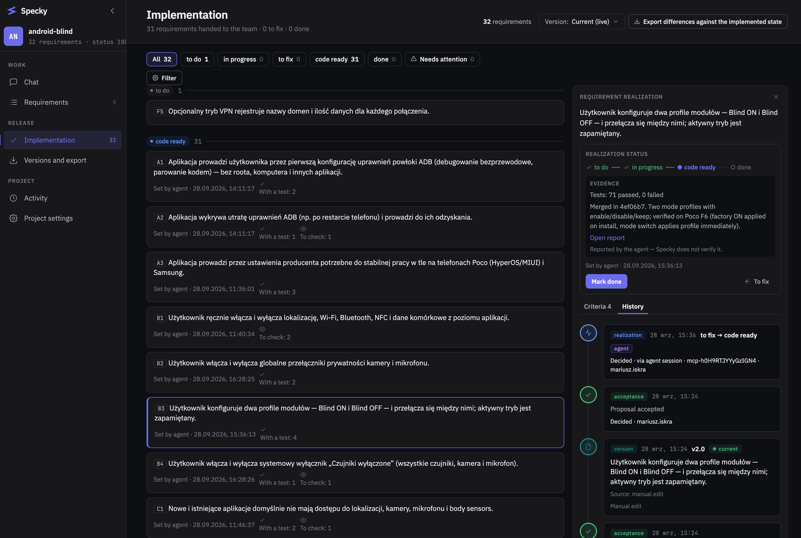
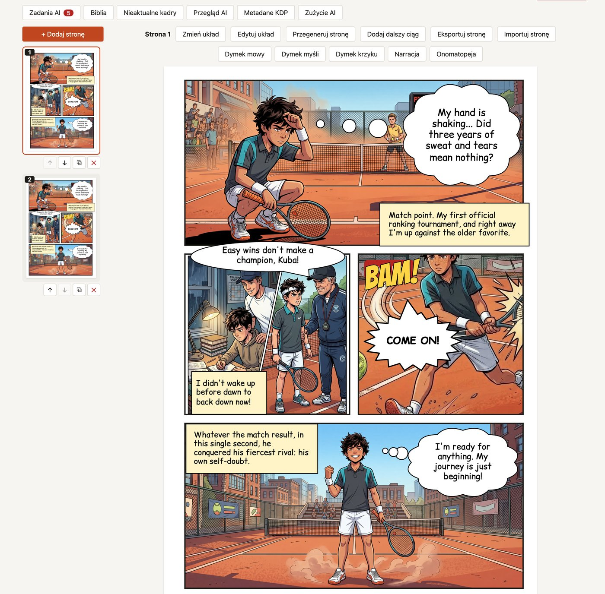
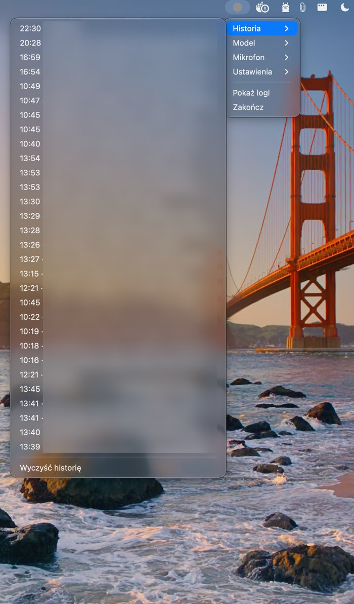
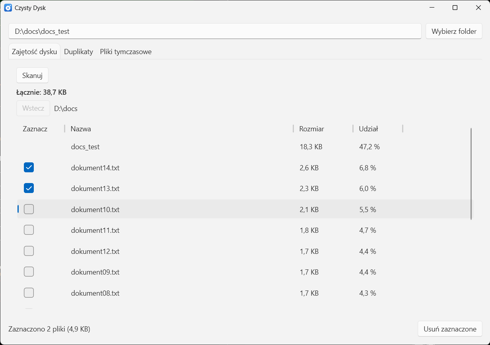
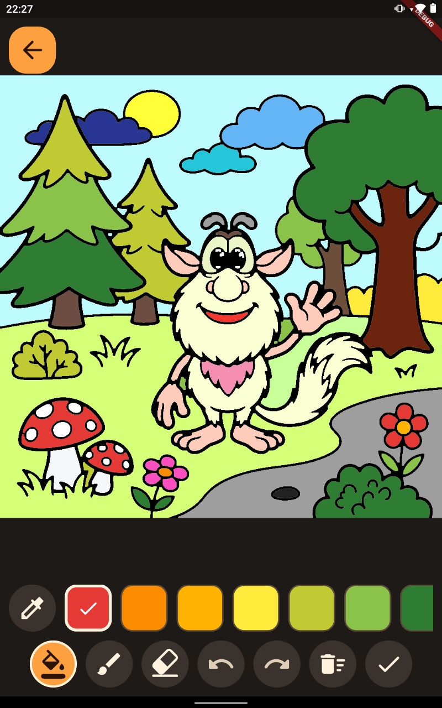
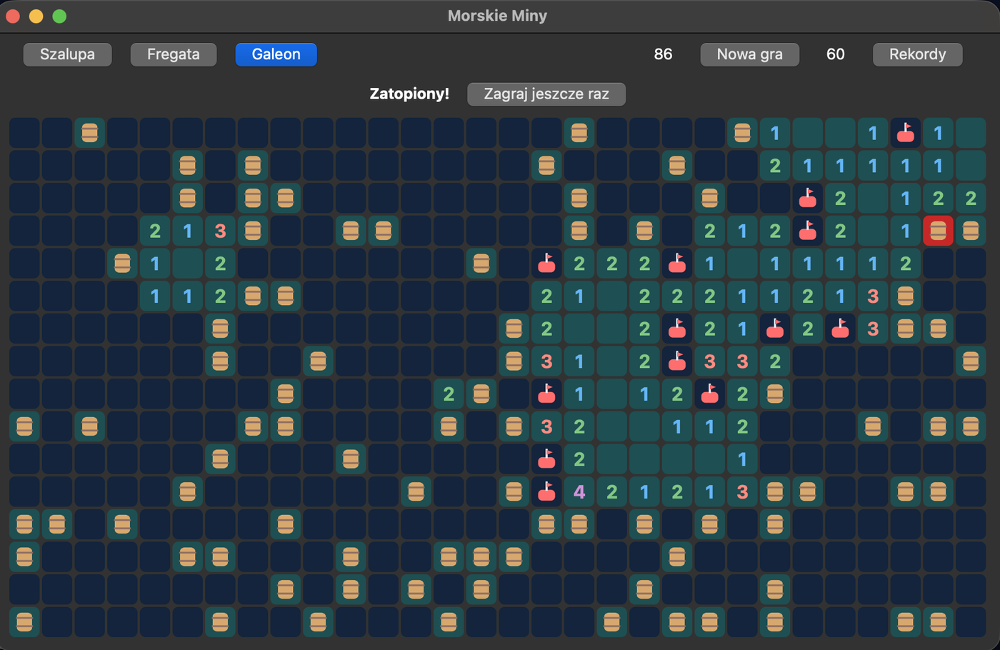

# Built with Telesma

Programs, games and tools people have built with Telesma — what they are, who built them and
what it took, including what went wrong. Every entry comes from its author; nothing here is
collected by telemetry.

## Add yours

Open a discussion in the **Show and tell** category of
[GitHub Discussions](https://github.com/mario12358/telesma/discussions/categories/show-and-tell)
with the fields below and one or two screenshots. No pull request needed — entries are copied
here from there. Or send a pull request that adds your entry and its images to `docs/showcase/`.

What is listed:

- Your own idea and your own artwork, names and characters — no other company's characters,
  logos or game titles. A clone of an existing game with its name changed is not listed either.
- Honest numbers. "Three fixes, the window did not scale" says more than "works perfectly".
- Built with a released Telesma version (`git -C <telesma> describe --tags`). The first entries
  come from the author's own projects and are marked when they were built before a release.

## Entry template

```markdown
### <Program name>


<One sentence: what it does, for whom.>

- **Built by**: <a person who does not program | a developer> · <name or handle, optional>
- **Runs on**: <Windows | macOS | Linux | a browser> · **Technology**: <e.g. Python + PySide6>
- **Telesma**: <vX.Y.Z> · **Started from**: <an idea (--new interview) | a written specification>
- **What it took**: <time from idea to a working file, e.g. 2 evenings> · <N steps in the plan> ·
  <N fixes after trying it, and what they were, in one line>
- **Code**: <link, or "not public">
- **What the interview wrote**: <link to IDEA.md / REQUIREMENTS.md, optional — shows how an idea
  turned into a list of requirements>
```

## Programs

<!-- Numbers from each project's git history and plan; "what it took" is calendar
time from the first to the last commit, not hours of work. -->

### Specky



The specification as a contract between a coding agent and a person: requirements with acceptance
criteria, each fingerprinted and accepted by a human, with test evidence from CI pinned to them —
[app.specky.app](https://app.specky.app). Telesma's own Specky integration is built on it.

- **Built by**: a developer
- **Runs on**: a browser (and any MCP client) · **Technology**: Python 3.11 + FastAPI, React + TypeScript, PostgreSQL
- **Telesma**: pre-release · **Started from**: a written specification, then changes over half a year
- **What it took**: 6 months and running · over 1100 steps · 45 versions (to v0.45.0) · 34 logged bug fixes
- **Code**: not public

### Books Creator



A web app for making comics and picture books: pages from layout templates, images placed in the
panels — drawn by an AI on request.

- **Built by**: a developer
- **Runs on**: a browser · **Technology**: Deno + TypeScript API, React, PostgreSQL, Playwright end-to-end tests
- **Telesma**: pre-release · **Started from**: a four-line list of features, grown by 18 change requests
- **What it took**: 5 weeks · 169 steps · 6 versions (v1.0.0 → v1.5.0)
- **Code**: not public

### Voice Asystent



A macOS menu-bar app: hold a shortcut, speak, and the transcript is on the clipboard. Speech is
recognised on the Mac itself (Whisper large-v3-turbo on the GPU); no recording leaves the computer.

- **Built by**: a developer
- **Runs on**: macOS · **Technology**: Rust, whisper on Metal
- **Telesma**: pre-release · **Started from**: a written specification
- **What it took**: 6 days · 49 steps in 10 phases · 8 versions (v0.1.0 → v0.8.0)
- **Code**: not public

### Czysty Dysk



A disk cleaner for one person on Windows: which folders take the most space, duplicate files,
temporary files and the Recycle Bin — nothing is deleted without a question, and by default it goes
to the Recycle Bin; one file on the desktop, no internet. *In progress: disk usage and deleting
work; duplicates, temporary files and packaging are not built yet.*

- **Built by**: a person who does not program (the beginner experience)
- **Runs on**: Windows · **Technology**: C# / .NET 10, WPF (Fluent theme), xUnit + FlaUI window tests
- **Telesma**: 1.1.0 (release candidate) · **Started from**: a written specification (idea, requirements, user flow, technical notes — four short files)
- **What it took**: so far 5 h 43 min from the first to the last commit · 25 steps in 6 phases, 11 done ·
  0 fixes after trying it; Windows Smart App Control blocked the unsigned build three times (in the end
  even the tests) and stopped the work until the owner decides; the window tests caught a list that had
  lost its columns before anyone saw it
- **Code**: not public

### Kids Playground



A set of games for children on Android and macOS, from one code base. The first is a colouring
book: pick a ready page, or describe what you want to colour and an AI draws a new page with clean
black outlines for it, saved on the device. Colour by tapping an area to fill it, or with a brush.

- **Built by**: a developer
- **Runs on**: Android, macOS · **Technology**: Flutter; a small proxy keeps the image API key off the device
- **Telesma**: 1.1.0 (release candidate) · **Started from**: a written specification
- **What it took**: 3 days · 40 steps in 7 phases · versions v0.1.0 and v0.2.0
- **Code**: not public

### Morskie Miny



Minesweeper at sea: barrels of powder under the waves, buoys instead of flags, three ship-sized
levels and a table of best times — in Polish, one double-click macOS app, no internet.

- **Built by**: a person who does not program (the beginner experience)
- **Runs on**: macOS · **Technology**: Python 3.12 + PySide6, packaged with PyInstaller
- **Telesma**: 1.1.0 (release candidate) · **Started from**: an idea (`--new` interview)
- **What it took**: 41 minutes from the first to the last commit · 21 steps in 5 phases · 1 fix after trying it
- **Code**: not public
